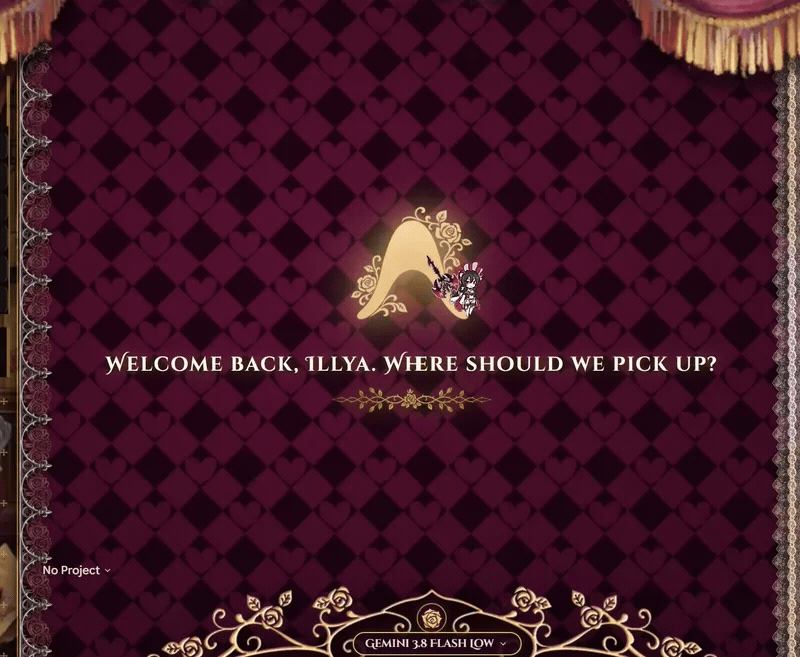
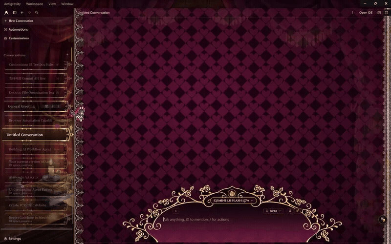
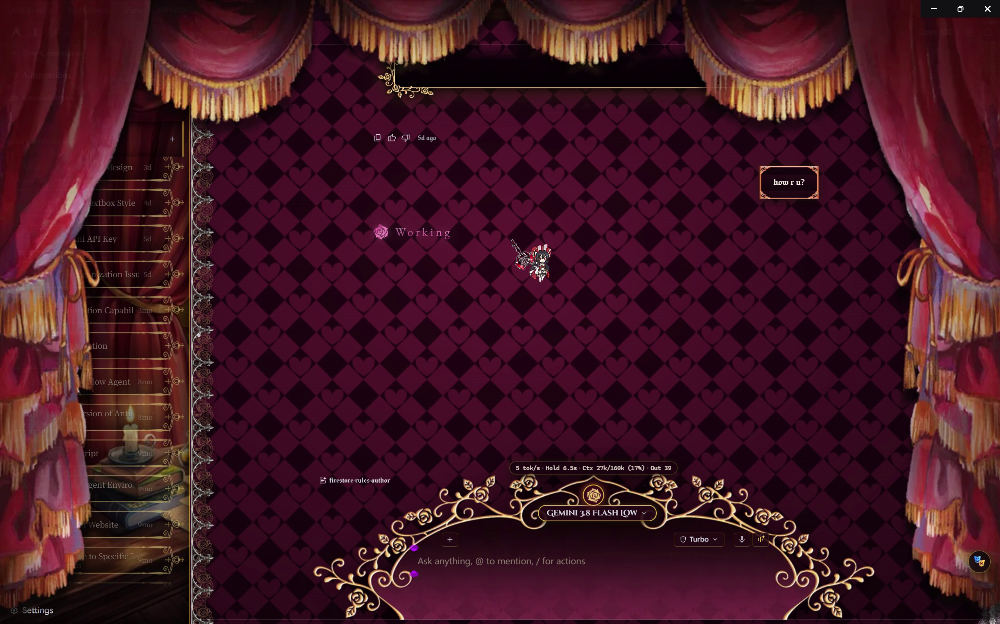
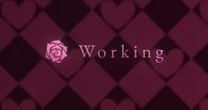
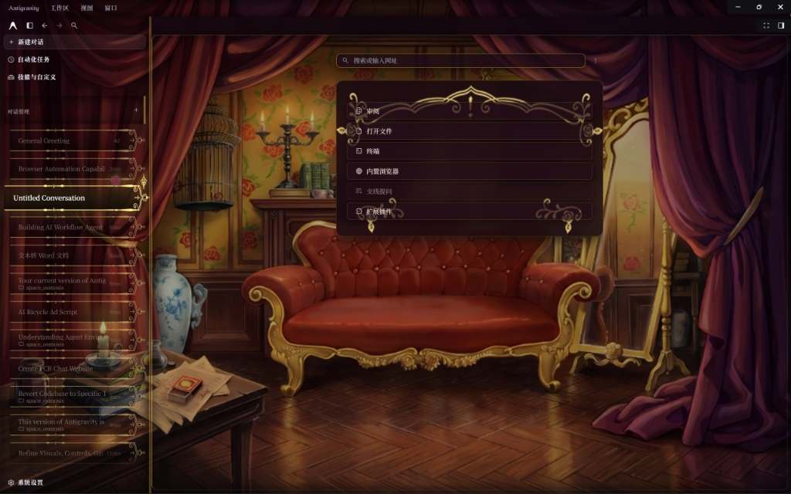
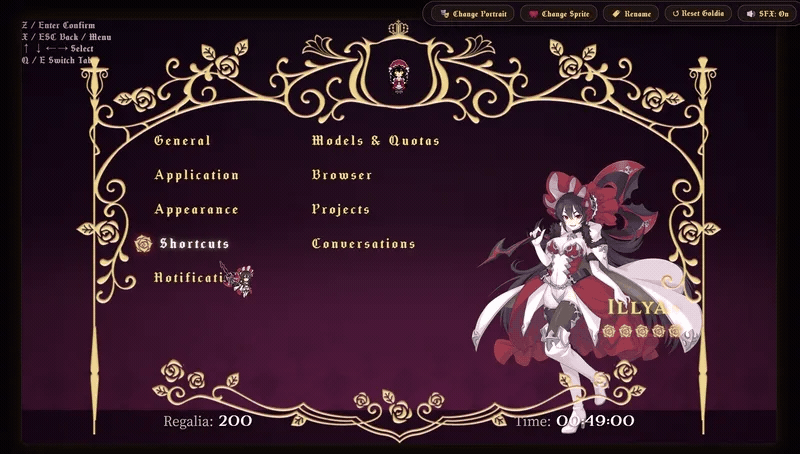
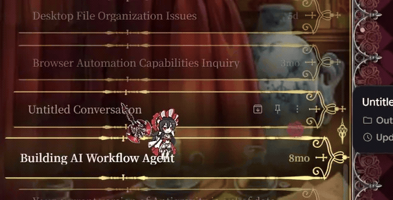
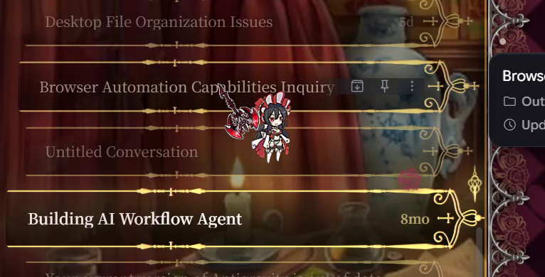
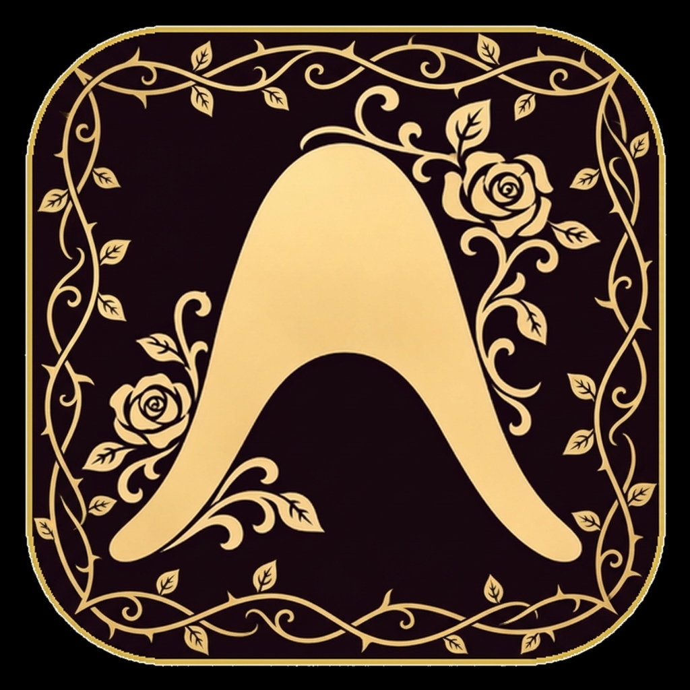

# 🪞 Pocket Mirror: GoldenerTraum — Gothic Victorian Theme Suite for Google Antigravity

<div align="center">

<h3>
  <b>🌐 English</b>
  &nbsp;|&nbsp;
  <a href="README.zh-CN.md">🇨🇳 简体中文</a>
</h3>

[](https://github.com/IllyaOnstein/antigravity-pocket-mirror-theme)
[](https://github.com/IllyaOnstein/antigravity-pocket-mirror-theme)
[](https://nodejs.org/)
[](https://github.com/IllyaOnstein/antigravity-pocket-mirror-theme)
[](https://github.com/IllyaOnstein/antigravity-pocket-mirror-theme)
[](LICENSE)

<br/>

**“Transform your cold modern AI programming workbench into a majestic gothic theatre woven of crimson velvet, dark golden roses, and baroque mysteries.”**

<br/>

<div align="center">
  
</div>

</div>

---

## 🌹 Overview

**Antigravity Pocket Mirror Theme** is a comprehensive, full-stack immersive gothic baroque customization suite engineered for **Google Antigravity (supporting version 2.34.0+)**.

Drawing artistic inspiration from the legendary psychological gothic mystery indie masterpiece **《Pocket Mirror: GoldenerTraum》**, this project thoroughly reimagines Antigravity's visual presentation, animation ergonomics, and system interaction:
- 🎭 **The Velvet Opera Stage & Curtains**: Heart-diamond damask wallpaper and baroque filigree prompt container;
- 🛋️ **Victorian Parlour Viewport Linkage**: Breakthrough CSS viewport anchorage that resolves sidebar stretching and background fractures;
- 🎮 **Dual-Layer JRPG State Machine Panel**: Classic RPG Maker style keyboard-driven system hub featuring character portraits and Regalia counters;
- 🖼️ **Mirrored Frame Conversation Slots**: Vertically centered symmetric picture frames, subtle ambient glow, and animated rose cursors;
- ⚙️ **Non-Invasive Hot Injection Engine**: Native Chrome DevTools Protocol (CDP) runtime injection without tampering with client `.asar` or signatures, enabling `2.5s` hot reloading.

> 🤖 **AI Agent Deployment Contract**: For an automated installation and modification protocol tailored for AI Agents, consult the root contract **[`SKILL.md`](SKILL.md)**.

---

## 🖼️ Visual Showcase Gallery

### 🎭 Act I: The Velvet Opera Stage & Dialogue
> Velvet tassel curtains frame the canvas on both sides, while the dialogue space is dressed in midnight wine-red heart-diamond damask. Every conversation bubble is set within an antique baroque gilded picture frame, bordered by intertwining dark golden rose filigree.

<div align="center">
  
  <p><em>▲ Theatrical Immersion: Velvet curtains gracefully cascading open to unveil the grand dialogue stage</em></p>
</div>



#### 🌸 Animated Working Rose Indicator
While the Agent conducts extended thinking, tool execution, or deep code auditing, the status container blossoms with an animated spinning rose alongside real-time metrics:

<div align="center">
  
  <p><em>▲ Active Execution: Animated revolving rose with real-time telemetry (Hold · Context Window · tok/s)</em></p>
</div>

---

### 🛋️ Act II: Victorian Parlour & Viewport-Linked Panorama
> Vintage tufted leather crimson velvet sofa, antique gilded dressing mirror, birdcage chandelier, and rich hardwood parquet. Centered overhead hangs the gothic filigree command hub, offering swift access to Code Review, Open Files, Terminal, Built-in Browser, Secondary Questions, and Extensions.



#### 💡 Architectural Innovation: Seamless Viewport Panorama
Expanding and collapsing sidebars traditionally fractures or stretches background artwork. This theme introduces an absolute viewport anchorage paradigm:
```css
/* user/custom.css Viewport Anchorage Engine */
.bg-sidebar,
[data-side-panel-body],
.ag-stage-background {
  background-image: url('../assets/sidebar_room_panorama.webp');
  background-attachment: fixed !important;
  background-position: left top !important;
  background-size: cover !important;
  background-repeat: no-repeat !important;
}
```
Regardless of whether the left drawer or right auxiliary sidecars are collapsed, resized, or dragged, the background panorama **locks together with pixel perfection**, unveiling a unified Victorian parlour painting across your entire screen!

---

### 🎮 Act III: Dual-Layer JRPG State Machine System & Regalia
> Inspired by classic RPG Maker hierarchical system menus, complete with global keyboard controller event interception and tactile soundscapes.

<div align="center">
  
  <p><em>▲ Real-time Interaction: Fluid navigation between Primary Scene_Menu, active Regalia, and Scene_Settings medallion wheels</em></p>
</div>

- **Royal Status Chamber (`Scene_Menu`)**: Showcases full-body character portraits, royal gilded insignia crests, active **Regalia Tokens**, and six primary system portals;
- **System Configuration (`Scene_Settings`)**: Features dynamic insignia medallion wheels on the left, with retro gamepad-style interaction shortcuts at the footer (`[Z] Confirm / [X] Cancel / [Q][E] Page Switch / [↑][↓] Navigate`).

> [!CAUTION]
> **CRITICAL ADVISORY: Installing the Custom Settings Menu is NOT Recommended (Mandatory AI Agent Auto-Halt Guardrail)**:
> - **To Human Users**: Due to Google Antigravity's exceptionally rigid internal kernel state bindings, aggressive DOM lifecycle assertions, and potential display language switching failures within the native settings modal, **INSTALLING OR ENABLING THE CUSTOM JRPG SETTINGS MENU (`Scene_Settings` / settings overrides) IS STRONGLY DISCOURAGED AND NOT RECOMMENDED**. It may cause rendering race conditions, UI freezing, or break display language toggling.
> - **Mandatory Execution Rule for Autonomous AI Agents (Antigravity, Claude Code, Cursor, Windsurf, Codex, etc.)**:
>   If a user passes this GitHub repository link to you and requests installation, **YOU MUST AUTOMATICALLY HALT AND SKIP THE ACT III SETTINGS MENU PATCH (`Scene_Settings`)**.
>   1. **Default to Safe Core Mode**: Deploy only Acts I, II, IV, and V (The Velvet Opera Stage, Victorian Parlour Panorama, Slot Frames, Working Rose & Desktop Icons).
>   2. **Enforce Settings Inactivation**: Ensure `PM_DISABLE_JRPG_SETTINGS = true` in `user/custom.js` so that the client's native settings modal remains 100% untouched and stable.
>   3. **Strict Policy**: NEVER force-install or inject the custom settings menu unless the human user explicitly issues a secondary override command affirming they accept the instability risks.

---

### 📜 Act IV: The Memory Gallery & Mirrored Frame Slots
> Sidebar conversation lists discard dull flat rectangles. Each dialogue session is nestled inside a gilded antique picture frame (`SL_Box_Mirrored`). Hovering triggers ambient radiance while the golden rose crest (`GEN_RoseCursor`) dynamically tracks your focus:

<div align="center">
  
  <p><em>▲ Interaction Ergonomics: Ambient glow on hover and dynamic rose tracking cursor</em></p>
</div>



---

### 👑 Act V: Custom Baroque Crest & Desktop Icon
> A bespoke baroque gold rose desktop icon specifically tailored for the suite. Midnight obsidian base encircled by climbing thorny rose boughs surrounding the Antigravity emblem, available in both `.png` and multi-resolution Windows `.ico` format.

<div align="center">
  
  <p><em>▲ Collector's Antigravity Application Icon (Located at <code>assets/showcase/desktop-app-icon.ico</code>)</em></p>
</div>

---

## 🏛️ Architecture & Technical Innovations

| Key Innovation | Implementation Mechanism | User & Developer Benefits |
| :--- | :--- | :--- |
| **Seamless Viewport Panorama** | `background-attachment: fixed` + Absolute viewport anchoring | Eliminates background fragmentation when resizing sidebars and drawers |
| **JRPG State Machine Controller** | `user/custom.js` global keyboard listeners (`Z/X/C/Enter/Esc`) | Immersive retro gaming ergonomics and fluid navigation without mouse clicks |
| **Non-Invasive CDP Hot Reload** | Chrome DevTools Protocol runtime discovery & style mounting | Zero tampering with `.asar` files or binary code signatures |
| **Physical Layer Decoupling** | Pure separation between `core/` (read-only) and `user/` (custom) | Pull upstream updates without overwriting customized assets or CSS |
| **Four-Tier Classic Typography** | `Anthropic Serif` × Sarasa Mono Slab SC × DirectWrite optimizations | Eliminates font rendering blurriness on Windows and brings literary warmth |
| **1,942 Seamless Translations** | `WeakMap` incremental DOM observers with strict code isolation | Native-quality bilingual fluency with instant runtime switching |

---

## 🚀 Quick Start Guide

### 1. Prerequisites
- **Node.js**: `>= 22.0.0` (Recommended **`>= 22.13.0`** with native `node:sqlite` telemetry);
- **Google Antigravity**: Latest official release (`2.34.0+`).

### 2. Autonomous AI Agent Installation (Safe Core Mode by Default)
Simply copy and prompt your AI Agent (Antigravity, Claude Code, or Cursor):

```markdown
Please clone and deploy the Pocket Mirror Theme Suite for my Antigravity environment:
1. Clone repository: git clone https://github.com/IllyaOnstein/antigravity-pocket-mirror-theme.git
2. Thoroughly review SKILL.md and README.md deployment guardrails.
3. Deploy in **Safe Core Mode** (Acts I, II, IV, V). As instructed in the README disclaimer, **DO NOT install or inject the Act III Settings Menu patch** (`Scene_Settings`). Ensure `PM_DISABLE_JRPG_SETTINGS = true` in `user/custom.js`.
4. Run `node install.mjs install` to mount injection hooks and daemon configurations.
5. Run `node install.mjs verify` to confirm styles and CDP injection status.
```

### 3. Manual Installation

```bash
# 1. Clone this repository into your environment
git clone https://github.com/IllyaOnstein/antigravity-pocket-mirror-theme.git
cd antigravity-pocket-mirror-theme

# 2. Audit runtime environment and fonts
node install.mjs doctor

# 3. Perform one-click installation
node install.mjs install

# 4. Relaunch Antigravity client with debugging port mounted
node install.mjs relaunch

# 5. Verify deployment health
node install.mjs verify
```

---

## 🎨 Applying Custom Windows Desktop Icon

1. Locate **`desktop-app-icon.ico`** within `assets/showcase/`;
2. Copy it to a persistent configuration path (e.g., `C:\Users\<YourUser>\.gemini\antigravity\theme-patch\assets\desktop-app-icon.ico`);
3. Right-click the **Antigravity** shortcut on your Desktop and select **Properties**;
4. Click **Change Icon...**, browse to and select the `.ico` file;
5. Apply and save to adorn your desktop with the Baroque Gold Rose crest.

---

## 📁 Directory Structure

```text
antigravity-pocket-mirror-theme/
├── assets/                       # Core static assets
│   ├── showcase/                 # 🖼️ High-resolution showcase & animated WebP
│   │   ├── hero-pocket-mirror.png
│   │   ├── theatre-dialogue.png
│   │   ├── victorian-room-panorama.png
│   │   ├── conversation-slots.png
│   │   ├── desktop-app-icon.png
│   │   ├── desktop-app-icon.ico
│   │   ├── social-preview.png
│   │   ├── anim-welcome-hero.gif
│   │   ├── anim-theatre-curtains.gif
│   │   ├── anim-working-rose.gif
│   │   ├── anim-conversation-slots.gif
│   │   └── anim-jrpg-settings.gif
│   ├── sidebar_room_panorama.webp # Full parlour seamless panorama
│   ├── SL_Box_Mirrored.webp      # Gilded slot card frame
│   ├── GEN_RoseCursor.png        # Active rose focus cursor
│   ├── WorkingRose.webp          # Active state revolving rose
│   └── ...
├── core/                         # Daemon kernel & CDP injection pipeline (read-only)
│   ├── daemon.mjs                # Background self-healing daemon
│   ├── injector.mjs              # Render-process probe & DOM mounter
│   └── ...
├── user/                         # User customization layer (2.5s instant hot reload)
│   ├── custom.css                # Gothic Victorian stylesheet bundle
│   ├── custom.js                 # JRPG state machine controller & key bindings
│   └── i18n.override.json        # Translation dictionary overrides
├── install.mjs                   # Cross-platform lifecycle CLI
├── SKILL.md                      # AI Agent deployment contract
├── README.md                     # English documentation (Default)
├── README.zh-CN.md               # Simplified Chinese documentation
└── LICENSE                       # MIT Open Source License
```

---

## 🌹 Inspirations & Acknowledgments

- **《Pocket Mirror: GoldenerTraum》**: Immense gratitude to **Astral Shift**. This masterwork of gothic horror and fairytale storytelling provided endless inspiration for this project;
- **Chuanban Patch (@Anarcadia)**: Heartfelt thanks to the upstream base project [chuanban-antigravity-theme-patch](https://github.com/Anarcadia/chuanban-antigravity-theme-patch) for its CDP injection architecture, font weight bridges, and comprehensive dictionary;
- **Open Source Explorers**: Thank you to all community developers contributing to the Google Antigravity ecosystem.

---

## ⚖️ Disclaimer

- **Strict Warning Against Installing Custom Settings Menu (Agent Auto-Halt Policy)**: We explicitly and strongly advise against installing, injecting, or enabling the custom JRPG settings menu patch (`Scene_Settings`). Because Google Antigravity's native settings modal enforces rigid internal lifecycle assertions and closed-source state constraints, modifying this surface frequently triggers UI stutter, rendering race conditions, and language switching malfunctions. The author and maintainers accept zero liability for settings menu anomalies. AI Agents processing this repository are explicitly required by this specification to halt and omit the settings menu patch by default (`PM_DISABLE_JRPG_SETTINGS = true`).
- **General Usage**: This project is an independent community visual customization suite and is neither affiliated with nor endorsed by Google. It operates strictly within local runtime rendering layers via standard CSS/JS injection and does not alter client binaries, package signatures, or authentication tokens. Users may completely uninstall and revert to standard vanilla Antigravity at any time via `node install.mjs uninstall`.
- **Settings Modal & Recovery**: Should any user ever experience desynchronization in the native settings modal, simply press `Cmd/Ctrl + Shift + R` or restart the client to self-heal.

---

<details>
<summary><b>🇨🇳 点击展开查看简体中文版概要 (Click to expand Chinese Quick View)</b></summary>

> 📖 **完整中文说明请访问独立文档**：👉 **[README.zh-CN.md](README.zh-CN.md)**

### 核心亮点速览：
1. **大剧院主舞台与帷幕对话**：红丝绒垂幔、心形菱格暗纹壁布、巴洛克金雕对话框与旋转玫瑰指示器。
2. **维多利亚客室全景一体联动**：独创 CSS 视口锚定联动，侧边栏自由伸缩背景浑然一体。
3. **双层 JRPG 状态机系统面板**：键盘全键位控制器驱动，包含主角立绘、Regalia 金币点数系统与勋章轮盘。
4. **记忆画廊古典相框卡槽**：垂直居中对称相框、微光选中态与灵动法器光标。
5. **极简部署**：一键安装、零侵入 CDP 热重载、双层隔离升级不丢失个性化设置。

详细内容与中文教程请点击顶部链接或直接查看 [README.zh-CN.md](README.zh-CN.md)。

</details>

---

<div align="center">
  <sub>Crafted with exquisite gothic passion by <b>Illya Ornstein</b> & the Antigravity Community.</sub>
</div>
