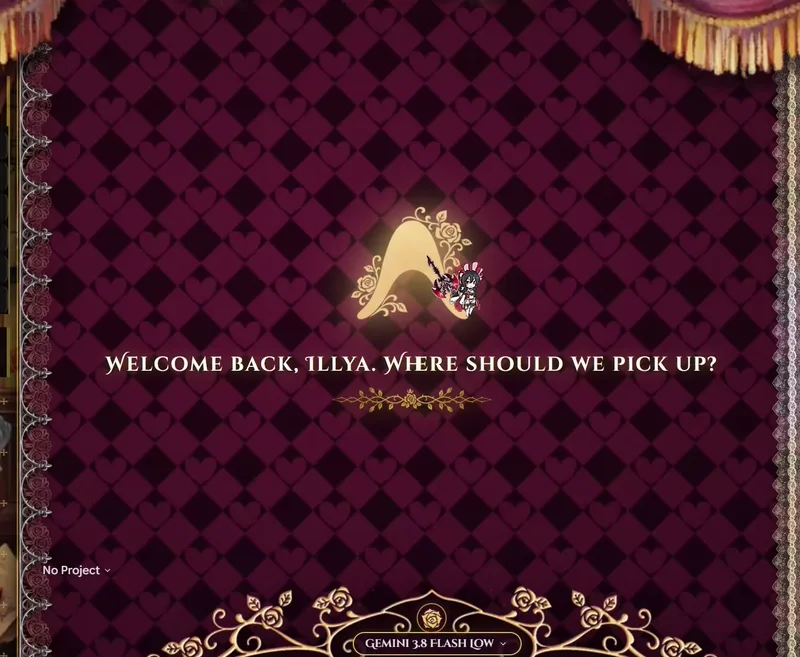
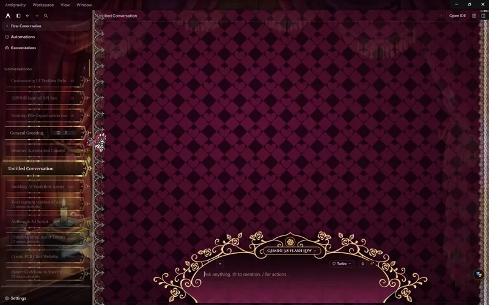
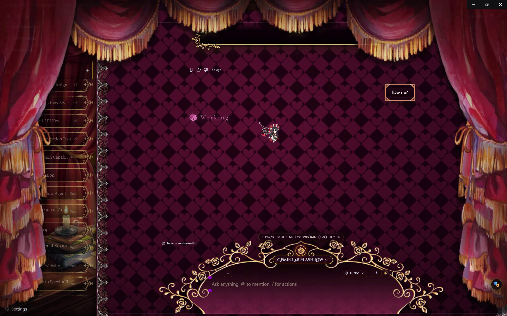
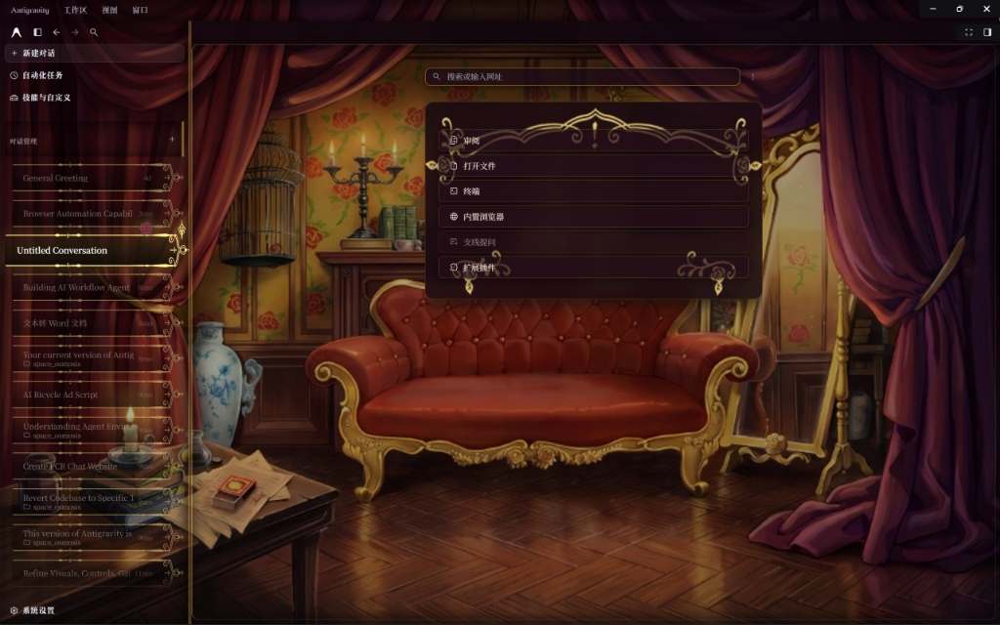
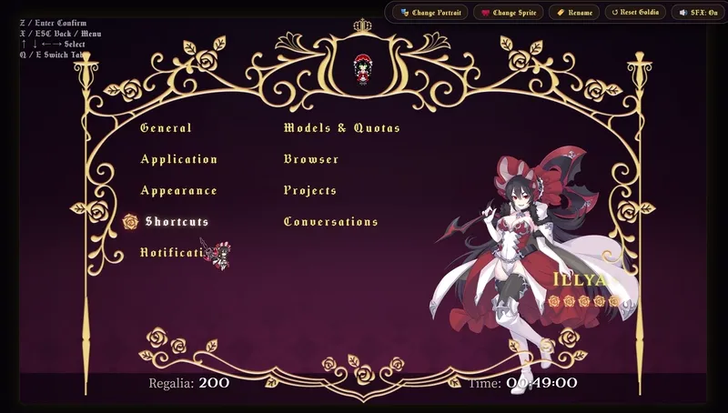
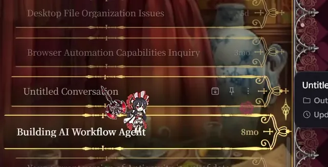
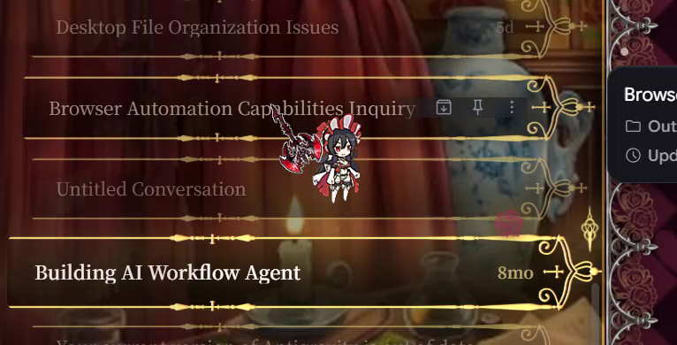

# 🪞 Pocket Mirror: GoldenerTraum — Gothic Victorian Theme Suite for Google Antigravity
> **面向 Google Antigravity 的《金纽扣之镜》哥特玫瑰维多利亚沉浸式主题套件**

<div align="center">

<h3>
  <a href="README.md">🌐 English</a>
  &nbsp;|&nbsp;
  <b>🇨🇳 简体中文</b>
</h3>

[](https://github.com/IllyaOnstein/antigravity-pocket-mirror-theme)
[](https://github.com/IllyaOnstein/antigravity-pocket-mirror-theme)
[](https://nodejs.org/)
[](https://github.com/IllyaOnstein/antigravity-pocket-mirror-theme)
[](https://github.com/IllyaOnstein/antigravity-pocket-mirror-theme)
[](LICENSE)

<br/>

**“将冷峻的现代 AI 编程工作台，化作一座流淌着红丝绒、暗夜金玫瑰与古典巴洛克秘境的哥特大剧院。”**

<br/>

<div align="center">
  
</div>

</div>

---

## 🌹 项目概述 (Overview)

**Antigravity Pocket Mirror Theme** 是一套面向 **Google Antigravity（支持 2.34.0+ 最新版本）** 的全栈沉浸式哥特巴洛克高定主题套件。

本项目以经典哥特心理悬疑独立神作 **《Pocket Mirror: GoldenerTraum》（金纽扣之镜）** 的艺术美学为灵魂，全面重构了 Antigravity 的前端视觉、动效交互与系统菜单体系：
- 🎭 **大剧院红丝绒帷幕舞台**：心形菱格暗纹壁布与巴洛克金雕浮雕输入框；
- 🛋️ **维多利亚客室全景视口一体联动**：独创 CSS 视口咬合，彻底解决侧边栏伸缩断层；
- 🎮 **双层 JRPG 状态机系统面板**：键盘驱动的复古 RPG Maker 状态机，带皇室立绘与 Regalia 点数；
- 🖼️ **古典相框会话卡槽**：垂直居中对称相框、微光选中态与灵动玫瑰法器光标；
- ⚙️ **零侵入热注入内核**：基于 CDP 运行时注入，无需篡改客户端 `.asar` 与二进制，支持 `2.5s` 极速热重载。

> 🤖 **AI Agent 部署契约**：供 AI Agent 读取并自动执行的完整生命周期规约见根目录 **[`SKILL.md`](SKILL.md)**。

---

## 🖼️ 视觉艺术画廊 (Visual Showcase Gallery)

### 🎭 Act I: 大剧院主舞台与帷幕对话 (The Velvet Opera Stage & Dialogue)
> 红丝绒流苏垂幔分列左右，对话区域采用深绯紫暗夜心形菱格壁布。每一条对话气泡均镶嵌古典巴洛克金雕画框，底部主输入框被整圈繁复的暗金玫瑰藤蔓环抱。

<div align="center">
  
  <p><em>▲ 剧院级仪式感：红丝绒帷幕优雅垂落展开与舞台收拢的实机动效</em></p>
</div>



#### 🌸 灵动运转指示器 (Working Rose Indicator)
在 Agent 进行思考、代码执行与长任务排查时，状态栏将绽放平滑旋转的粉红玫瑰，并伴随毫秒级流式速率与上下文水位线监控：

<div align="center">
  
  <p><em>▲ 任务运行态：粉红旋转玫瑰与实时上下文遥测（Hold · Ctx · tok/s）</em></p>
</div>

---

### 🛋️ Act II: 维多利亚大客室 · 全景视口一体联动 (Victorian Parlour & Seamless Panorama)
> 复古拉扣真皮红丝绒沙发、落地金框试衣镜、鸟笼烛台与深褐拼木地板。居中悬浮着哥特雕花操作中枢，提供【审阅 / 打开文件 / 终端 / 内置浏览器 / 支线提问 / 扩展插件】快捷调度。



#### 💡 独创技术：全景视口一体联动 (Viewport Seamless Panorama)
传统的侧边栏展开通常会导致背景图被横向切断或拉伸挤压。本项目采用现代视口锚定联动方案：
```css
/* user/custom.css 视口无缝联动引擎 */
.bg-sidebar,
[data-side-panel-body],
.ag-stage-background {
  background-image: url('../assets/sidebar_room_panorama.webp');
  background-attachment: fixed !important;
  background-position: left top !important;
  background-size: cover !important;
  background-repeat: no-repeat !important;
}
```
左侧边栏与右侧副栏在动态伸缩展开时，背景底图**永远像素级精准咬合**，共同拼出浑然一体的维多利亚豪华客厅原画！

---

### 🎮 Act III: 双层 JRPG 状态机设置面板 (Dual-Layer JRPG System & Regalia)
> 灵感源自经典 JRPG（RPG Maker）的经典分层菜单状态机，内置完整的全局键盘控制器拦截与音效联动。

<div align="center">
  
  <p><em>▲ 实机动态交互：一级皇家状态机、Regalia 点数系统与二级勋章轮盘参数面板的平滑键盘流转</em></p>
</div>

- **皇家状态面板 (`Scene_Menu`)**：展示精美的主角立绘、皇室暗金纹章、当前持有的 **Regalia 点数**，以及六大核心系统导航菜单；
- **系统参数面板 (`Scene_Settings`)**：左侧浮现金色勋章轮盘，底栏提供全套红白机/手柄风格的实体按键指南（`[Z] 确认 / [X] 取消 / [Q][E] 翻页 / [↑][↓] 导航`）。

> [!WARNING]
> **关于设置菜单与语言切换的已知限制与免责声明**:
> 鉴于 Google Antigravity 官方客户端对原生系统设置菜单的底层内核（框架内部状态机与生命周期门禁）控制极其严苛，本主题套件在设置界面注入的 JRPG 菜单与即时中英双语切换器在部分场景下可能会出现微小 UI 渲染竞态、轻微卡顿或偶发语言切换失败的情况。这属于上游客户端封闭内核的物理限制，并不会影响主界面对话、代码编写与 Agent 的日常业务。若遇到设置界面状态异常，只需按下快捷键 `Cmd/Ctrl + Shift + R` 强制刷新或重启客户端即可平滑自愈。

---

### 📜 Act IV: 记忆之廊 · 古典相框会话卡槽 (The Memory Gallery)
> 侧边栏历史会话列表彻底告别原生枯燥的扁平色块。每一条会话均封装于精致的古典相框卡槽（`SL_Box_Mirrored`）之中，高亮激活态散发暗金微光，并由浮动玫瑰光标（`GEN_RoseCursor`）指引：

<div align="center">
  
  <p><em>▲ 交互动效：相框卡槽悬停微光扩散与玫瑰激活光标动态追踪</em></p>
</div>



---

### 👑 Act V: 专属桌面圣印与应用图标 (Custom Baroque Desktop Icon)
> 我们为整套主题定制了专属的巴洛克金玫瑰缠藤应用图标。黑色曜石底色与烫金玫瑰藤蔓缠绕着经典 Antigravity 徽章，提供 `.png` 与 Windows 原生多尺寸 `.ico` 文件。

<div align="center">
  
  <p><em>▲ 典藏版 Antigravity 桌面快捷方式图标（内置于 <code>assets/showcase/desktop-app-icon.ico</code>）</em></p>
</div>

---

## 🏛️ 核心架构与工程创新 (Architecture & Engineering)

| 核心创新点 | 技术实现方案 | 带来的体验提升 |
| :--- | :--- | :--- |
| **全景视口一体联动** | `background-attachment: fixed` + 视口绝对像素对齐 | 彻底消灭侧栏与主工作台背景撕裂，伸缩抽屉自然露出沙发大厅 |
| **JRPG 键盘状态机引擎** | `user/custom.js` 注入全键盘事件拦截器 (`Z/X/C/Enter/Esc`) | 沉浸式复古游戏操控体验，菜单切换行云流水 |
| **零侵入 CDP 热重载** | Chrome DevTools Protocol 运行时自动化端口探测与注入 | 不修改官方 `.asar`、不破坏二进制代码签名，安全零风控 |
| **物理分层改装隔离** | `core/` (只读内核) 与 `user/` (个性化配置) 物理解耦 | 上游补丁迭代无缝拉取，个人定制样式与素材 100% 永久保留 |
| **四层古典衬线排版** | `Anthropic Serif` × 更纱黑体 UI 字重桥接 × `DirectWrite` 优化 | 告别发虚毛刺，中文印刷级润墨，西文古典优雅 |
| **1,942 条无感界面汉化** | `WeakMap` 增量 DOM 树监听 + 严苛代码块隔离 | 母语级精准汉化，支持中英双语无感即时热切换 |

---

## 🚀 极简部署指南 (Quick Start)

### 1. 前置依赖
- **Node.js**: `>= 22.0.0`（推荐 **`>= 22.13.0`**，自带原生 `node:sqlite` 支持）；
- **Google Antigravity**: 支持官方最新版本（`2.34.0+`）。

### 2. 一键让你的 AI Agent 完成部署
复制以下指令直接发送给你的 AI Agent（无论是 Antigravity、Claude Code 还是 Cursor）：

```markdown
请帮我克隆并部署 Pocket Mirror 主题套件：
1. 克隆仓库：git clone https://github.com/IllyaOnstein/antigravity-pocket-mirror-theme.git
2. 完整阅读仓库中的 SKILL.md 部署规范。
3. 执行 node install.mjs install 完成自动注入与守护进程配置。
4. 执行 node install.mjs verify 验证主题加载状态。
```

### 3. 手动安装步骤 (Manual Installation)

```bash
# 1. 克隆本仓库到你的配置或工作目录
git clone https://github.com/IllyaOnstein/antigravity-pocket-mirror-theme.git
cd antigravity-pocket-mirror-theme

# 2. 检查环境与字体依赖
node install.mjs doctor

# 3. 执行一键安装
node install.mjs install

# 4. 重启 Antigravity 客户端（挂载调试端口）
node install.mjs relaunch

# 5. 校验安装结果
node install.mjs verify
```

---

## 🎨 更换桌面定制图标教程 (Windows Desktop Icon)

1. 在仓库的 `assets/showcase/` 目录下找到 **`desktop-app-icon.ico`**；
2. 建议将其复制保存至稳定目录（如 `C:\Users\<你的用户名>\.gemini\antigravity\theme-patch\assets\desktop-app-icon.ico`）；
3. 右键点击桌面上的 **Antigravity** 快捷方式，选择 **「属性」**；
4. 点击 **「更换图标 (Change Icon...)」**，浏览并选中刚刚的 `.ico` 文件；
5. 点击「确定」并保存，你的桌面即刻拥有巴洛克暗金玫瑰专属圣印！

---

## 📁 目录结构 (Directory Structure)

```text
antigravity-pocket-mirror-theme/
├── assets/                       # 核心静态素材库
│   ├── showcase/                 # 🖼️ README 高清展示画廊与动效 WebP
│   │   ├── hero-pocket-mirror.png
│   │   ├── theatre-dialogue.png
│   │   ├── victorian-room-panorama.png
│   │   ├── conversation-slots.png
│   │   ├── desktop-app-icon.png
│   │   ├── desktop-app-icon.ico
│   │   ├── social-preview.png
│   │   ├── anim-welcome-hero.webp
│   │   ├── anim-theatre-curtains.webp
│   │   ├── anim-working-rose.webp
│   │   ├── anim-conversation-slots.webp
│   │   └── anim-jrpg-settings.webp
│   ├── sidebar_room_panorama.webp # 客室联动全景原画
│   ├── SL_Box_Mirrored.webp      # 镜像卡槽底图
│   ├── GEN_RoseCursor.png        # 激活玫瑰光标
│   ├── WorkingRose.webp          # 运行态旋转玫瑰动效
│   └── ...
├── core/                         # 守护进程内核与 CDP 注入引擎 (只读)
│   ├── daemon.mjs                # 后台保活守护脚本
│   ├── injector.mjs              # 渲染进程探针与样式挂载
│   └── ...
├── user/                         # 个人配置与定制层 (2.5s 极速热重载)
│   ├── custom.css                # 哥特维多利亚样式总成
│   ├── custom.js                 # JRPG 状态机控制器与键盘监听
│   └── i18n.override.json        # 汉化微调与自定义词条
├── install.mjs                   # 跨平台生命周期管理 CLI
├── SKILL.md                      # AI Agent 自动部署规约
├── README.md                     # 英文主文档 (Default)
├── README.zh-CN.md               # 简体中文说明文档
└── LICENSE                       # MIT 开源协议
```

---

## 🌹 致谢与灵感 (Inspirations & Credits)

- **《Pocket Mirror: GoldenerTraum》**：特别致敬开发团队 **Astral Shift**。这部伟大的哥特解谜艺术作品赋予了本项目无穷的灵感与美学指引；
- **川板补丁 (@Anarcadia)**：感谢上游基座项目 [chuanban-antigravity-theme-patch](https://github.com/Anarcadia/chuanban-antigravity-theme-patch) 提供的卓越 CDP 注入引擎、字体字重桥接方案与高品质汉化词表；
- **开源贡献者们**：感谢所有为 Antigravity 生态贡献力量的开发者与探索者。

---

## ⚖️ 免责声明 (Disclaimer)

- **常规使用声明**：本项目为独立的非官方社区视觉定制套件，与 Google 没有任何关联或背书。本主题套件仅在本地运行时渲染层注入 CSS 与交互动效，不修改客户端安装包二进制与代码签名，不接触网络鉴权凭据，使用者可随时通过 `node install.mjs uninstall` 彻底卸载并无损还原。
- **设置菜单与语言切换限制说明**：由于 Google Antigravity 官方客户端底层对设置菜单内核的校验与生命周期拦截极其严格，二级 JRPG 菜单与即时中英双语切换器在极个别情况下可能会出现轻微 bug、渲染延迟或切换失效。这属于上游客户端封闭架构的客观物理限制，完全不影响核心工作流。若遇异常，按 `Cmd/Ctrl + Shift + R` 或重启即可恢复。

---

<div align="center">
  <sub>Crafted with exquisite gothic passion by <b>Illya Ornstein</b> & the Antigravity Community.</sub>
</div>
